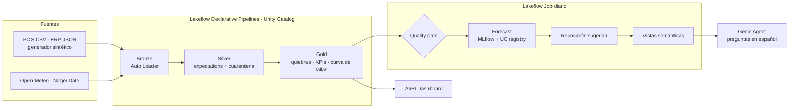

# RetailClothingStore · Lakehouse para retail de ropa en Databricks

[](https://github.com/narichunarze/RetailClothingStore/actions/workflows/ci.yml)

Simulación de un engagement de **Forward Deployed Engineer** de punta a punta: discovery con el negocio, arquitectura, desarrollo AI-first, CI/CD y producción en Databricks.

## El problema

**AndesMart** (ficticia) tiene 12 tiendas de ropa en Perú, Chile, Colombia y México y unos 760 SKUs (modelo × color × talla). El problema de negocio: *"se nos acaban las tallas M y L de lo que más se vende y terminamos la temporada liquidando XS y XL"*. Los reportes se consolidan a mano en Excel cada semana y no hay forecast. → [Discovery completo](docs/01-discovery.md)

## El hallazgo

Los quiebres no son un problema de volumen sino de **curva de tallas**. La reposición actual reparte cada pedido **en partes iguales entre tallas**, mientras que la demanda se concentra en M y L.

| | Global | Talla M | Talla L | Talla XS |
|---|---|---|---|---|
| Tasa de quiebre (días-SKU) | 4,5% | **12%** | **9%** | 0,3% |

*Cifras con los datos por defecto del generador (seed 42).*

## La solución



| Capa | Qué hace | Detalle |
|---|---|---|
| **Ingesta** | Auto Loader incremental; todo string en Bronze y `_rescued_data` | [ADR-0002](docs/adr/0002-lakeflow-declarative-pipelines.md) |
| **Calidad** | Reglas declarativas: las filas inválidas van a tablas `*_quarantine` con el motivo. Un quality gate frena el job si la cuarentena supera el 1% | [CI/CD](docs/06-cicd.md) |
| **Gold** | Ventas, quiebre diario por SKU, KPIs semanales, curva de tallas y **venta perdida estimada** | [Datos](docs/04-source-data.md) |
| **ML** | Forecast semanal global (HistGradientBoosting, Poisson), entrenado con demanda *sin censura* (venta + venta perdida). Solo recibe el alias `champion` si le gana al baseline | [Forecast](docs/07-forecast.md) |
| **Reposición** | Revisión periódica con stock de seguridad, comparada contra el reparto parejo actual | [Forecast](docs/07-forecast.md) |
| **IA para el negocio** | Vistas en español con definiciones por columna, consultadas por un Genie Agent | [Genie](docs/08-genie.md) |
| **Gobernanza** | El grupo de negocio solo lee las vistas semánticas (`GRANT SELECT`), no las tablas base | [Genie](docs/08-genie.md) |
| **DevOps** | Asset Bundles (dev/prod), GitHub Actions: lint, tests, validate y deploy a prod en cada merge | [CI/CD](docs/06-cicd.md) |

## Resultados

| Qué | Resultado |
|---|---|
| Venta perdida estimada vs. la real del generador | **~8% de error**. La primera versión se pasaba en un 60%; se encontró y corrigió la causa (snapshot al cierre) |
| Forecast, WAPE tienda × modelo-color (8 semanas, 2 años de historia) | **0,27** contra 0,40 de "semana anterior" y 0,33 del promedio de 4 semanas. País × categoría: **0,16** |
| Reposición, talla M (ropa, una semana) | El modelo envía **2.832 u.** contra 489 del reparto parejo; XS y XXL bajan a 0 |
| **Backtest de la política** (mismo año, misma demanda) | **−57% de venta perdida** y quiebre de 5,5% a 3,5%, con +0,4% de inventario ([detalle](docs/09-policy-backtest.md)) |
| Genie Agent | **12/12 benchmarks** en 4 iteraciones (6 → 9 → 10 → 12) |
| Tests | 44 tests (`pytest`), con validación end-to-end contra la verdad del generador |

> **Mensaje para el negocio:** no hace falta comprar más inventario; hace falta enviar la curva de tallas correcta a cada tienda.

## AI-first, con criterio

Todo se desarrolló con Claude Code. El [AI Log](AI_LOG.md) registra qué generó la IA y qué hubo que corregir. Algunos ejemplos:
- La simulación de reposición original creaba un **espiral de quiebres**: la demanda perdida era 3 veces lo vendido.
- El estimador de venta perdida **inflaba un 60%** los resultados; se detectó al validarlo contra la verdad del generador.
- El tipo `decimal` de Spark se convertía en objetos `Decimal` en pandas y **rompía el forecast**; se detectó antes de llegar a producción.
- **Incidente en prod:** deploys concurrentes pisaban archivos mientras el job los leía. Se corrigió en el CI, encolando los deploys.

## Decisiones y trade-offs

- [ADR-0001](docs/adr/0001-medallion-lakehouse.md) Medallion sobre Delta Lake
- [ADR-0002](docs/adr/0002-lakeflow-declarative-pipelines.md) Lakeflow Declarative Pipelines, con la lógica en funciones testeables
- [ADR-0003](docs/adr/0003-asset-bundles-cicd.md) Asset Bundles + GitHub Actions

**Limitaciones de Free Edition** (en un cliente real se haría distinto):
- Un solo workspace: dev y prod separados por schema, con la misma landing zone.
- Deploy con token personal, en lugar de un *service principal*.

## Cómo correrlo

```bash
pip install -r requirements-dev.txt
pytest
python -m src.data_gen.generate --out data/raw --truth data/truth
databricks fs cp -r data/raw dbfs:/Volumes/workspace/andesmart_dev/raw
databricks bundle deploy -t dev
databricks bundle run andesmart_daily -t dev
```

Detalle de setup: [plan de trabajo](docs/03-plan.md) y [datos fuente](docs/04-source-data.md).

## Próximos pasos

1. **Piloto A/B** en tiendas reales para validar el backtest fuera de la simulación.
2. **Agente con herramientas** (Agent Bricks / Mosaic AI) que explique cada sugerencia al planner.
3. **Producción real**: service principal, workspaces separados y monitoreo de drift del modelo.

## Estructura

```
databricks.yml · resources/      bundle: pipeline, job, targets dev/prod
src/data_gen/                    generador sintético + APIs externas
src/pipelines/{bronze,silver,gold}/
src/transforms.py                lógica Silver/Gold (testeada)
src/ml/                          features, entrenamiento y reposición
src/semantic.py                  vistas para Genie + benchmarks
src/jobs/                        notebooks del job (quality gate, forecast, capa semántica)
tests/                           pytest
docs/                            discovery, arquitectura, ADRs, guías
```
