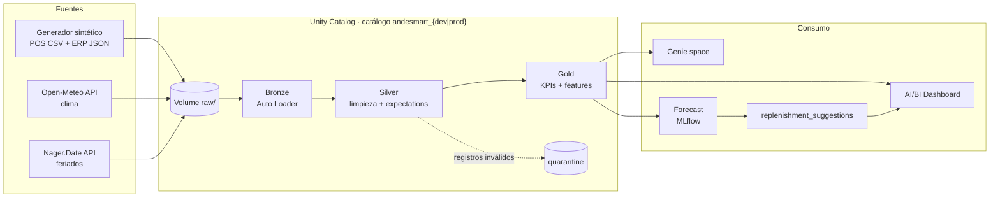

# 02 · Arquitectura

## Vista general

## Capas (medallion)

| Capa | Tablas | Responsabilidad |
|---|---|---|
| **Bronze** | `bronze_sales`, `bronze_inventory`, `bronze_weather`, `bronze_holidays` | Ingesta incremental tal cual llega (Auto Loader), + metadatos `_ingested_at`, `_source_file` |
| **Silver** | `silver_sales`, `silver_inventory`, `silver_products`, `silver_stores`, `silver_weather`, `silver_holidays` | Tipos correctos, deduplicación, expectations (precio ≥ 0, cantidad > 0, claves no nulas) |
| **Gold** | `gold_daily_sales`, `gold_stockout_daily`, `gold_kpi_weekly`, `gold_size_curve` (Fase 5: `gold_demand_features`) | Modelos de negocio listos para BI y ML |
| **ML out** | `gold_demand_forecast`, `gold_replenishment_suggestions` | Salida del forecast y lógica de reposición |

## Stack

| Necesidad | Tecnología | Por qué |
|---|---|---|
| Ingesta y transformaciones | Lakeflow Declarative Pipelines (SQL/PySpark) + Auto Loader | Incremental, calidad declarativa, linaje automático |
| Almacenamiento | Delta Lake | ACID, time travel, MERGE |
| Gobernanza | Unity Catalog (catálogo, schemas, volumes, grants) | Seguridad por rol y linaje |
| Orquestación | Lakeflow Jobs | Pipeline → forecast → refresh dashboard |
| ML | MLflow (tracking + registry en UC) | Reproducibilidad y comparación vs. baseline |
| Consumo | AI/BI Dashboard + Genie | Autoservicio para el negocio |
| Infra como código | Databricks Asset Bundles (`databricks.yml`) | Mismo código en dev/prod |
| CI/CD | GitHub Actions + `pytest` + `ruff` | Tests de transformaciones y deploy automático |
| Desarrollo | Claude Code / Cursor | AI-first, documentado en `AI_LOG.md` |

## Entornos

| Target | Catálogo | Disparo |
|---|---|---|
| `dev` | `workspace` / schema `andesmart_dev` | Deploy manual o en PR |
| `prod` | `workspace` / schema `andesmart_prod` | Merge a `main` |

> Free Edition tiene un único workspace y cuotas, así que dev/prod se separan por **schema** en lugar de por catálogo/workspace. En un cliente real serían workspaces/catálogos distintos (ver ADR-0003).

## Decisiones clave

Ver [`adr/`](adr/).
