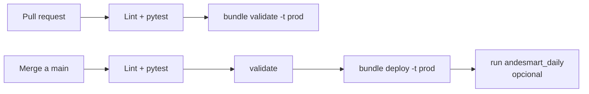

# 06 · Orquestación y CI/CD

## Flujo

| Evento | Qué corre |
|---|---|
| Pull request | `ruff`, `pytest` y `bundle validate` (si está habilitado) |
| Push / merge a `main` | Lo anterior + `bundle deploy -t prod` (+ corrida del job si `RUN_AFTER_DEPLOY`) |
| Manual | Actions → CI/CD → **Run workflow** |

## Job diario `andesmart_daily`

1. `refresh_medallion`: pipeline Bronze → Silver → Gold.
2. `quality_gate` (`src/jobs/quality_gate.py`): falla el job si:
   - alguna tabla clave está vacía;
   - la cuarentena de ventas supera el 1%;
   - la tasa de quiebre sale de rango (0–30%).

   Las reglas están en `src/quality.py` y se testean en `tests/test_quality.py`.
3. (Fase 5) forecast y reposición: solo corren si pasa el gate.

Si el job falla, avisa por email al dueño del bundle. Las tareas de notebook reintentan una vez.

> **Lección aprendida:** los deploys a `main` hacen cola en vez de cancelarse. Cancelar un `bundle deploy` a medias deja archivos incompletos en el workspace, y el job que corre en paralelo falla con `Input/output error`.

## Configuración en GitHub (una vez)

1. **Secrets** (Settings → Secrets and variables → Actions → *Secrets*): `DATABRICKS_HOST`, `DATABRICKS_TOKEN` ✅
2. **Variables** (misma página → *Variables*):
   - `DEPLOY_ENABLED` = `true`
   - `RUN_AFTER_DEPLOY` = `true` (opcional; consume cuota de Free Edition)
3. **Environment** `prod` (Settings → Environments → New environment): opcional, para exigir aprobación manual antes del deploy (*Required reviewers*).
4. **Protección de `main`** (Settings → Branches → Add rule): exigir PR y que pase *Lint + tests*.

## Entornos

| | dev | prod |
|---|---|---|
| Schema | `andesmart_dev` | `andesmart_prod` |
| Quién despliega | tú, desde tu PC | GitHub Actions |
| Nombres | prefijo `[dev <usuario>]` | sin prefijo |
| Schedules | pausados siempre | `schedule_status` (PAUSED por cuota) |
| Datos crudos | landing compartida `/Volumes/workspace/andesmart_dev/raw` | igual |

> Limitación de Free Edition (ver ADR-0003): un solo workspace, con dev y prod separados por schema y la misma landing zone. Con un cliente real habría un workspace o catálogo por entorno, un *service principal* para el deploy en lugar de un token personal, y una landing zone por entorno.
